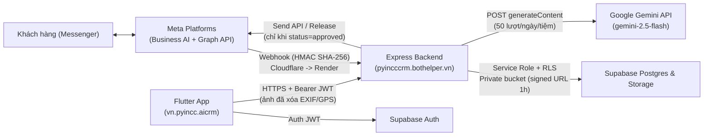

# Kiến trúc hệ thống (ARCHITECTURE) — PYINCC AI CRM

## 1. Thành phần và ranh giới trách nhiệm

## 2. Ranh giới giữa Meta, Backend và Gemini

- **Flutter App:** Chỉ giữ `SUPABASE_URL`, `SUPABASE_ANON_KEY` (publishable) và `TRYON_API_URL`. Mọi thao tác nghiệp vụ đi qua Backend bằng JWT phiên đăng nhập. Không bao giờ giữ Page Token hay API key bí mật.
- **Backend Express (`backend_bridge/meta-webhook/index.js`):**
  - Chạy sau chuỗi proxy **Cloudflare → Render** (`trust proxy = TRUST_PROXY_HOPS || 2`).
  - Xác thực người dùng bằng `supabase.auth.getUser(token)` và bắt buộc `role = 'owner'` cùng `status = 'active'` trên mọi API nghiệp vụ (`403 FORBIDDEN_ROLE` cho mọi vai trò khác).
  - Mã hóa Page Access Token bằng **AES-256-GCM** (`PAGE_TOKEN_ENC_KEY`) trước khi lưu vào `connected_pages`.
  - Xác thực chữ ký `X-Hub-Signature-256` của Meta bằng `crypto.timingSafeEqual` trên raw body.
  - Áp dụng `express-rate-limit` riêng cho các route nhạy cảm (`authWriteLimiter`) và route ghi (`writeLimiter`).
- **Gemini:** Chỉ được Backend gọi khi chủ tiệm chủ động gọi `POST /handoff-cases/capture` hoặc `POST /handoff-cases/:id/analyze`. Gemini không nhận Page Token, không gọi Graph API và không gửi tin nhắn.

## 3. Luồng dữ liệu cốt lõi

### Luồng B — Chủ tiệm chụp ảnh tại tiệm
1. Chủ tiệm chọn/chụp ảnh trong `TryOnStudioScreen` và xác nhận khách đã đồng ý.
2. `ImagePreprocessor` kiểm tra magic bytes (JPEG/PNG/WebP), kiểm tra độ phân giải `<= 24 MP` từ header trước khi decode, xoay theo EXIF, dựng lại pixel RGB sạch (xóa 100% EXIF/GPS/ICC) và nén trên isolate (`compute`).
3. App gửi `POST /handoff-cases/capture` → Backend kiểm tra kích thước, magic bytes, `GEMINI_API_KEY` và hạn mức `50/ngày` trước khi upload vào bucket private `customer-media/owner/<org_id>/...`.
4. Backend gọi Gemini, lưu kết quả vào `handoff_cases` ở trạng thái `pending_review`. **Không gọi Facebook.**
5. Chủ tiệm sửa & bấm **Duyệt** (`POST /handoff-cases/:id/approve`) → trạng thái `approved`, ghi `approved_by`, `approved_at`, `audit_logs`. **Vẫn chưa gửi.**
6. Nếu ca có `psid` & `page_id`, chủ tiệm bấm **Gửi** (`POST /handoff-cases/:id/send`) → claim nguyên tử `approved → sending` (chống gửi trùng `409 ALREADY_SENDING`) → gọi Meta Send API → cập nhật `sent` và ghi `audit_logs`.

### Luồng A — Business AI chuyển ca (chỉ kích hoạt đầy đủ ở Phase 8)
- Sự kiện `standby`: chỉ ghi nhận vào `webhook_events`, không trả lời.
- Sự kiện `pass_thread_control`: bật cờ `handover_threads.active = true` và ghi nhận tín hiệu; phần đọc `handoff_reason`, `take_thread_control`, kiểm tra `thread_owner` sẽ hoàn thiện sau khi có kết quả thử nghiệm nguyên văn trên Page test.

## 4. Cách ly dữ liệu đa tiệm (Multi-tenant)

- Toàn bộ bảng trong schema `public` đều bật **RLS**.
- Mọi truy vấn backend đều lọc tường minh theo `req.orgId` và bắt buộc `requireRole('owner')`.
- Đường dẫn Storage cách ly theo `owner/<orgId>/...` và `facebook/<orgId>/...`, truy cập bằng signed URL hết hạn sau 3600 giây.
- `public.user_org_ids()` và `public.user_owner_org_ids()` đều chỉ trả về `org_id` của `owner` đang `active`, đảm bảo khóa owner-only đồng nhất ở cả tầng Backend lẫn Postgres RLS.
